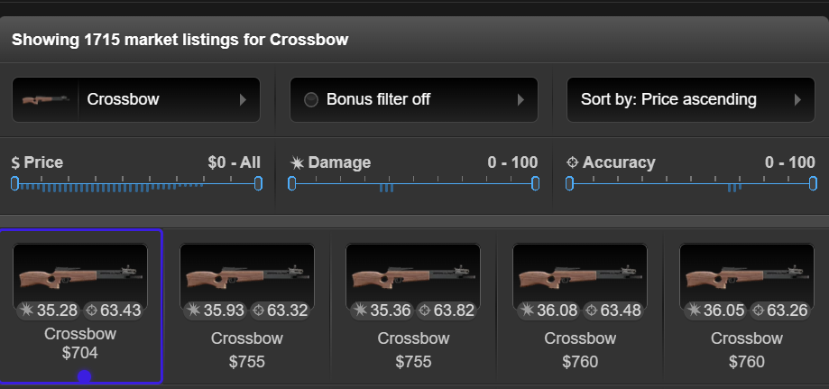
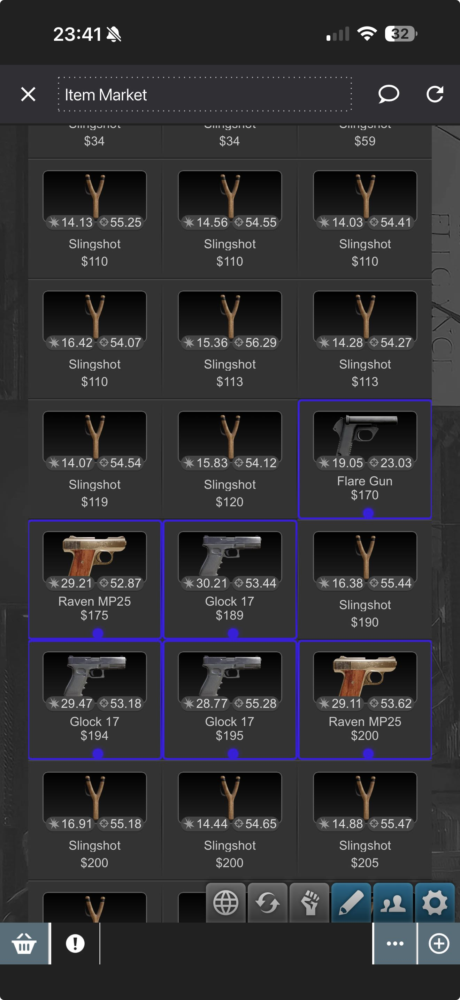
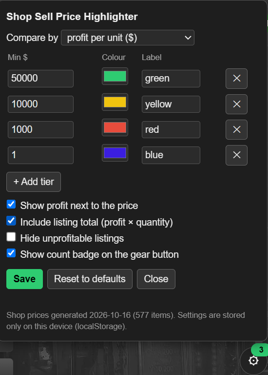

# Torn Item Market – Shop Sell Price Highlighter

[](https://github.com/tulpn/torn-item-market-highlighter/actions/workflows/test.yml)

A userscript for [Torn](https://www.torn.com) that highlights Item Market listings priced **below what a city shop pays for the item**. Buy them, sell them to Big Al's (or any other city shop), pocket the difference.

Works in the browser with Tampermonkey / Violentmonkey and on the phone in [Torn PDA](https://github.com/Manuito83/torn-pda).

<table>
  <tr>
    <th>Browser (Tampermonkey)</th>
    <th>Torn PDA</th>
  </tr>
  <tr valign="top">
    <td width="68%"></td>
    <td width="32%"></td>
  </tr>
</table>

## What it does

Every listing on the Item Market is compared against the fixed price a city shop pays for that item. If the market price is lower, the listing gets a coloured border, a coloured dot and a short profit label such as `+12.5k` next to the price. The colour tells you how much profit per unit you would make:

| Colour | Profit per unit |
| ------ | --------------- |
| Green  | 50,000 or more  |
| Yellow | 10,000 – 49,999 |
| Red    | 1,000 – 9,999   |
| Blue   | 1 – 999         |

Hover the price to see the item name, the shop price, the exact profit, the margin in percent and, when the listing shows a quantity, the total profit for the whole listing.

A small gear button in the bottom-right corner shows how many profitable listings are on the current page and opens the settings panel:

- **Tiers**: change thresholds, colours and labels, add or remove tiers.
- **Compare by**: profit per unit in dollars, or margin as a percentage of the market price. Each mode has its own set of tiers.
- **Inline label**: show or hide the profit label next to the price.
- **Listing total**: include profit × quantity in the label and tooltip.
- **Hide unprofitable listings**: collapse everything that is not worth buying.
- **Count badge**: show or hide the number on the gear button.



Settings are saved on your device, so they survive script updates. In Torn PDA they go into the app's per-script storage, which the PDA team recommends over localStorage because it is not evicted under memory pressure. In a browser they go into localStorage.

## Install

### Browser (Tampermonkey / Violentmonkey)

1. Install [Tampermonkey](https://www.tampermonkey.net/) or [Violentmonkey](https://violentmonkey.github.io/).
2. Open the install link: **[torn-market-shop-price-highlighter.user.js](https://raw.githubusercontent.com/tulpn/torn-item-market-highlighter/main/torn-market-shop-price-highlighter.user.js)**
3. Confirm the install. Open the Item Market and you are done.

### Torn PDA

1. In Torn PDA go to **Settings → Userscripts → Add**.
2. Paste the raw URL above and save.
3. Open the Item Market inside the app.

No API key is needed. The script never asks for one and never makes a network request.

## How it works

1. **Shop sell prices are static**, so they are baked straight into the script as a lookup table (item ID → shop sell price). Items that no shop will buy are left out. The table is generated once with `build-prices.ps1` from the official Torn API and committed with the script.
2. **Listings are found by their item image.** Every listing on the Item Market carries an image whose URL contains the item ID. The script reads that ID and takes the nearest `$1,234` text as the listing price. No fragile class-name selectors, so Torn's regular UI reshuffles rarely break it.
3. **Profit = shop price − market price.** The result is matched against the colour tiers and the listing is decorated. A `MutationObserver` re-scans as you page through listings or switch categories.
4. **Decoration is attribute-only.** The border, dot and label are drawn with CSS from attributes on the existing elements, so the script never inserts nodes into Torn's listing markup and does not interfere with other scripts watching the page.
5. **Settings are loaded once at start-up** from Torn PDA's `PDA_storage` when the app injects it, otherwise from localStorage, and written back only when you press Save or Reset. This follows the [Torn PDA storage recommendations](https://github.com/Manuito83/torn-pda/blob/develop/userscripts/TornPDA_Storage.md).

## Torn rules

This script is designed to stay within Torn's scripting rules. It only reads the Item Market page you have opened yourself. It sends no requests to torn.com, performs no actions on your behalf, and cannot buy, sell or click anything. The Torn API is used only by the maintainer's build step to generate the price table, never at runtime.

Rules can change, and the final responsibility for what runs in your browser is yours. Read the current rules at [torn.com/rules.php](https://www.torn.com/rules.php) before installing any script.

## API Terms of Service

| Data Storage | Data Sharing | Purpose of Use | Key Storage & Sharing | Key Access Level |
| ------------ | ------------ | -------------- | --------------------- | ---------------- |
| Only locally. Your tier, colour and display preferences are kept in Torn PDA's per-script storage (`PDA_storage`) or, in a browser, in localStorage. Nothing about your account, inventory or trades is stored, and nothing is uploaded anywhere. | Nobody. No data is sent to the script author, other players or any third-party service. | Competitive advantage: highlighting Item Market listings priced below the city shop sell price. Market prices are read from the page you are viewing, not from the API. | Not applicable. The script never asks for, stores or sends an API key. The Torn API is used only by the author's offline build step (`torn/items`, public data) to generate the embedded price table. | None required. |

**Removing your data:** press **Reset to defaults** in the settings panel, or uninstall the script and clear site data for torn.com.

## Configuration

Use the settings panel (gear button on the Item Market page). Nothing needs to be edited in the file. `Min` is the per-unit profit, or the margin in percent, that a listing must reach to get that tier. Listings below the lowest `Min` are not highlighted. Add, remove or reorder tiers as you like; the script sorts them itself. **Reset to defaults** wipes your saved settings.

The defaults live at the top of the script in the `CONFIG` block. Saved settings always override them.

## Refreshing the price table

Torn very occasionally rebalances item values. To regenerate the embedded table, run from the repository folder:

```powershell
.\build-prices.ps1 -ApiKey YOUR_TORN_API_KEY
```

A key with **Public** access is enough. The script fetches `torn/items` once, rewrites the table between the `@@SHOP_PRICES_START` / `@@SHOP_PRICES_END` markers, and leaves everything else untouched. The key is only used by this build step and never ends up in the userscript.

## Development and tests

The script is tested against a fake Item Market page in [jsdom](https://github.com/jsdom/jsdom) using Node's built-in test runner. The tests cover tier colours, labels and tooltips, the settings panel, persistence in both storage backends, hostile data in storage, and live page mutations.

```powershell
npm install
npm test
```

`npm test` first syntax-checks the userscript, then runs everything in `test/`. The same command runs in GitHub Actions on every push and pull request.

### Security notes

- The settings panel is built with DOM calls only. There is no `innerHTML`, so a stored label can never become markup.
- Everything read from storage is treated as untrusted and normalised field by field: colours must be six-digit hex, thresholds must be finite and non-negative, labels are capped at 12 characters, unknown keys are dropped. This matters because localStorage on torn.com is shared with every other script you run.
- The script makes no network requests, uses no `GM_*` functions, and runs with `@grant none`.

## Known limitations

- Torn's Item Market is a React app with hashed class names. The script locates listings heuristically (image + nearest price), which is robust but not infallible. If a listing shows more than one dollar amount, the first one wins.
- Only the shop sell price is considered. Your own sell-related perks or events that temporarily change shop prices are not factored in.
- The listing quantity is read from the row text with a simple pattern (`x12`, `12x`, `qty 12`). If Torn shows it differently, the total is left out and only the per-unit profit is shown.

## Like the script?

If this script saves you money, please **give the [forum post](https://www.torn.com/forums.php#/p=threads&f=67&t=16611888&b=0&a=0&start=0&to=28029671) an upvote or leave a comment**. It helps me a lot and keeps the script visible for other players.

## More scripts

More Torn scripts will be published at **[www.torn-tracker.com/scripts](https://www.torn-tracker.com/scripts)**.

## Author & custom scripts

Written by **ares313377** – [Torn profile, ID 4372940](https://www.torn.com/profiles.php?XID=4372940).

Need a script tailored to your faction, your trading routine or anything else in Torn? Custom scripts can be ordered as needed, with pricing depending on scope.

- Read the service offering, ask questions and report bugs in the **[Torn forum thread](https://www.torn.com/forums.php#/p=threads&f=67&t=16611888&b=0&a=0&start=0&to=28029671)**. A reply there also bumps the thread so more players find the script.
- Or send a message in game to [ares313377 [4372940]](https://www.torn.com/profiles.php?XID=4372940).
- There is also a [Discord server](https://discord.gg/eBxAZF9qsJ) if you prefer chat.

## License

This script may be used and redistributed **as is**, but **not modified** or redistributed in modified form. Adjusting the `CONFIG` values for your own use is allowed. See [LICENSE](LICENSE) for the full terms.
